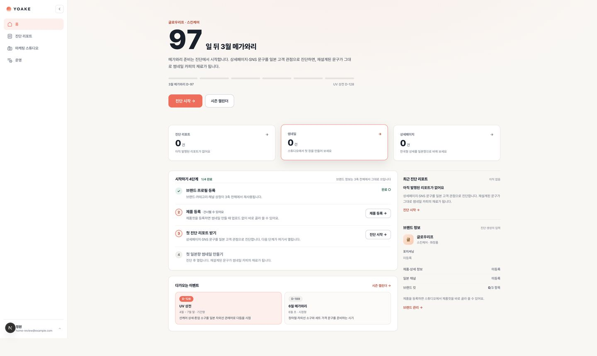
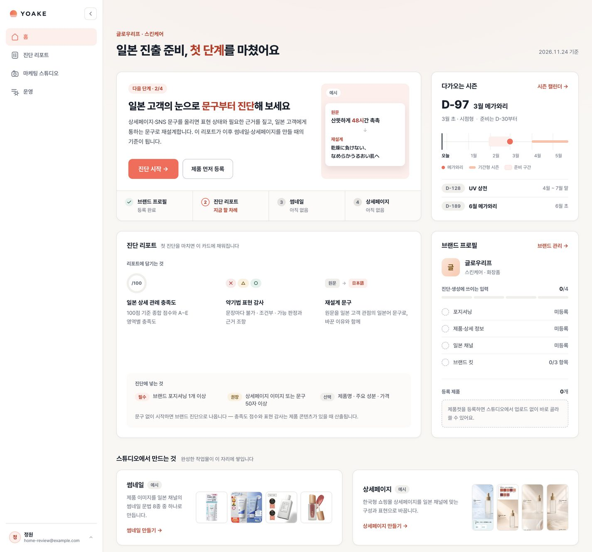
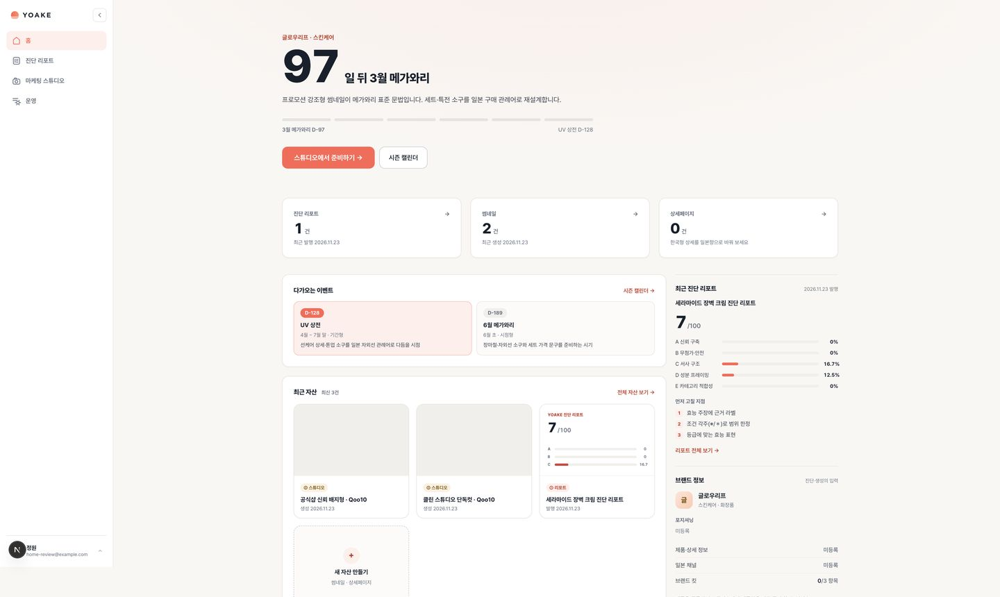
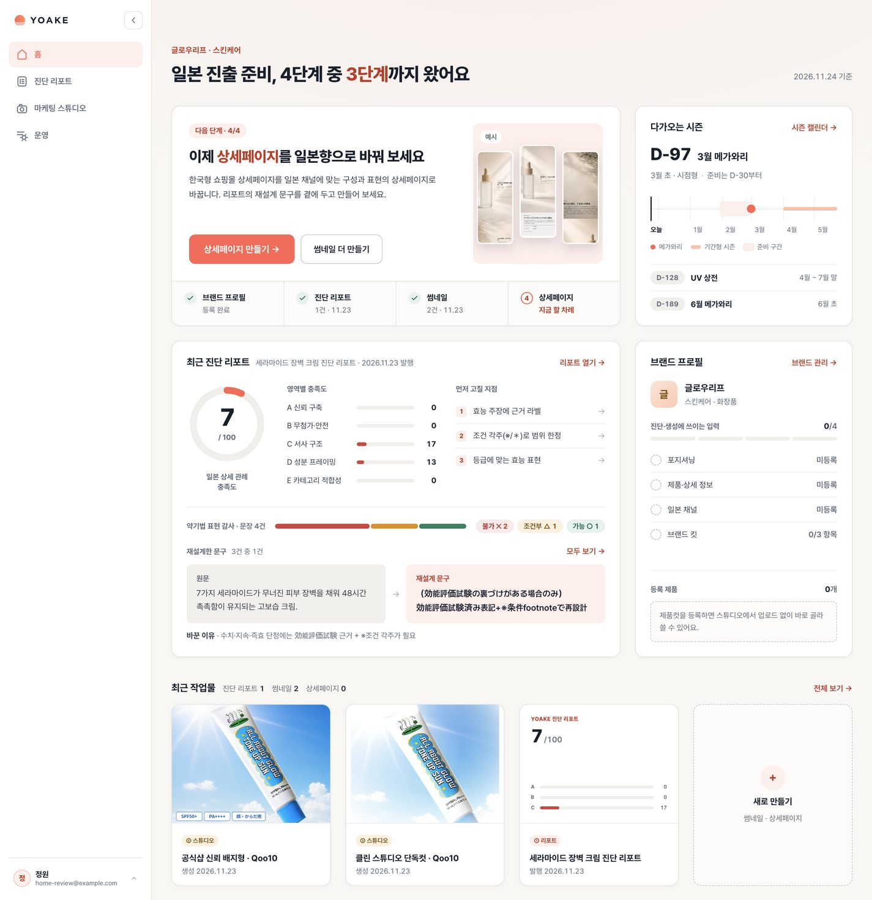

# 결정 — 홈을 "다음 단계" 중심의 카드 대시보드로 다시 짠다 (2026-11-24)

## 결정

로그인 후 홈(`/app`)을 **12열 격자 위의 카드 대시보드**로 다시 짠다. 화면의 주어는 다음 메가와리까지 남은 일수(100px 숫자)가 아니라 **지금 할 일 한 가지**다. 2026-08-20 "홈 머리 = 시즌 D-day 히어로" 개편을 대체한다.

화면은 질문 다섯 개에 차례로 답한다. 왼쪽 8열이 주 동선이고 오른쪽 4열이 그 줄의 맥락이다.

| 자리 | 답하는 질문 | 무엇이 놓이나 |
|---|---|---|
| 머리 | 어디까지 왔나 | "일본 진출 준비, 4단계 중 3단계까지 왔어요" |
| 확인할 것 | 내가 봐야 할 일이 있나 | 생성 실패 · 기업 매칭 제안 도착 (있을 때만) |
| 1줄 | 지금 무엇을 하나 · 언제까지 | **다음 단계 카드**(8) · **시즌 카드**(4) |
| 2줄 | 진단이 뭐라고 했나 · 무엇을 보고 도나 | **진단 카드**(8) · **브랜드 프로필 카드**(4) |
| 3줄 | 무엇을 만들었나 | **최근 작업물**(12) · 없으면 스튜디오 예시 |

| 첫 방문 — 전 | 첫 방문 — 후 |
|---|---|
|  |  |

| 복귀 — 전 | 복귀 — 후 |
|---|---|
|  |  |

- 구현: [app/app/page.tsx](../../app/app/page.tsx) · [HomeNextStep](../../components/app/HomeNextStep.tsx) · [HomeSeasonCard](../../components/app/HomeSeasonCard.tsx) · [HomeReportCard](../../components/app/HomeReportCard.tsx) · [HomeWidgets](../../components/app/HomeWidgets.tsx) · [homeUi](../../components/app/homeUi.tsx)
- 판정·계산: [lib/home/nextStep.ts](../../lib/home/nextStep.ts) · [lib/home/reportMaterial.ts](../../lib/home/reportMaterial.ts) · `seasonFocus`·`seasonWindow` in [lib/season.ts](../../lib/season.ts) (전부 단위 테스트)
- 화면 스펙: [[specs/00-main/00-main-ui-기획서]] 2026.11.24 행

## 개편 전 화면의 문제

로컬에서 첫 방문·복귀 두 상태를 띄워 놓고 확인한 것이다.

1. **가장 큰 글자에 동사가 없다.** "97일 뒤 3월 메가와리"가 100px인데, 그래서 무엇을 하라는지는 그 아래 15px 문장과 버튼이 말한다. 석 달 뒤 행사와 내일 행사가 같은 크기로 읽힌다.
2. **첫 방문의 두 번째 줄이 `0건 · 0건 · 0건`이다.** 건수 타일 3개가 가장 좋은 자리를 쓰면서 아무것도 전하지 않는다.
3. **같은 행선지가 세 번 나온다.** 첫 방문에서 "진단 시작"이 히어로 버튼 · 셋업 가이드 3단계 · 우측 리포트 위젯에 각각 있다.
4. **표면 문법이 넷이고 세로선이 어긋난다.** 카드 없는 히어로 · 카드 · 타일 · 머리선만 있는 칼럼이 섞여 있고, 섹션 제목(14px)이 히어로 설명문(15px)보다 작다.
5. **홈이 리포트의 숫자만 보여 준다.** 점수와 그룹 막대뿐이고, 이 서비스의 본체인 **원문이 어떻게 바뀌었는가**와 약기법 표현 감사 결과는 리포트 안으로 들어가야만 보인다.
6. **시즌이 숫자 하나다.** D-day 는 크게 있지만 앞으로 몇 달이 어떻게 생겼는지는 보이지 않는다.
7. **화면이 없는 연결을 약속한다.** 홈은 "재설계된 문구가 그대로 썸네일 카피의 재료가 됩니다", "(썸네일은) 진단 후 열립니다"라고 적는데, 코드에서 스튜디오는 리포트 결과를 읽지 않고(`lib/server/studioJob.ts`·`detailJob.ts`에 리포트 참조 없음) 진단 없이도 열린다. [[04-roadmap]] §0-4 가 "폐루프가 화면에서 반증됨"으로 적어 둔 바로 그 지점이다.

> 같은 날 1차 개편(카드 없는 히어로 + 준비 흐름 밴드 + 우측 머리선 칼럼)을 먼저 냈으나 "엉성한 대시보드"라는 평가를 받았다. 내용은 맞았지만 표면 문법이 여전히 섞여 있었고 오른쪽 열 폭이 줄마다 달랐다(400px / 340px). 이 문서는 그 뒤의 전면 재설계를 기록한다.

## 리서치 — 유사 서비스의 로그인 후 홈

네 영역으로 나눠 조사했다. 로그인 화면은 공개 크롤링이 안 되므로 **공식 도움말·제품 공지·디자인 시스템 문서**를 근거로 삼았고, 화면 갤러리(Mobbin 등)는 확인하지 못했다. 근거를 찾지 못한 서비스는 뺐다(Qoo10 QSM·라쿠텐 RMS·Cafe24·아임웹·미리캔버스·스티비 등).

### ① 진단·감사·점수형 툴 — 점수 옆에 "먼저 고칠 것"과 다음 행동을 붙인다

| 서비스 | 홈/개요가 하는 일 |
|---|---|
| [Semrush Site Audit](https://www.semrush.com/kb/540-site-audit-overview) | Site Health % · 오류/경고 합계 · **Top Issues를 한 띠에**. 출구는 "View all issues" 하나, 각 이슈 행에 "How to fix" |
| [Ahrefs Site Audit](https://help.ahrefs.com/en/articles/1424673-what-is-health-score-and-how-is-it-calculated-in-ahrefs-site-audit) | Health Score + 상위 이슈 10건으로 제한. 변화 열은 두 번째 실행부터 |
| [Lighthouse](https://developer.chrome.com/docs/lighthouse/performance/performance-scoring) | 점수와 개선 목록을 분리. "100점은 기대하지 않는다"고 명시 |
| [Vanta](https://www.vanta.com/resources/vantas-new-look-a-customer-based-redesign) · [Drata](https://help.drata.com/en/articles/13259515-dashboard-overview) | 고객이 "매일 무엇을 할지"를 원해 Priority tasks 신설 · **0% 카드는 숨긴다** |
| [HubSpot Website Grader](https://blog.hubspot.com/marketing/website-grader-relaunch) | 권장 사항이 리포트 맨 아래 — 점수에서 가장 먼 자리(반면교사) |
| [Shopify Web Performance](https://performance.shopify.com/blogs/blog/web-performance-dashboard) | 단일 속도 점수를 버리고 등급 카드 3개 + 가이드로 전환 |

→ **숫자만 세우지 않는다.** 현재 상태 + 무엇을 할지가 1단이고, 하위 점수는 분해일 뿐 경쟁하는 주인공이 아니다.

### ② AI 콘텐츠·크리에이티브 제작 툴 — 첫 화면은 "무엇을 만들까" 하나다

| 서비스 | 홈이 하는 일 |
|---|---|
| [Canva](https://brendacadman.com/how-to-navigate-the-canva-homepage/) | "What will you design today?" + 입력 1개 → 디자인 유형 줄 → 최근 디자인. 브랜드 킷은 내비 행선지 |
| [Gamma](https://help.gamma.app/en/articles/11016390-introduction-to-the-gamma-dashboard) | "What do you want to make?" → 바로가기 → 추천 템플릿. 최근 작업은 옆 패널 |
| [Descript](https://help.descript.com/descript-tour/drive-view) | 빠른 시작 과제 + 최근 프로젝트. 목표는 "빈 페이지의 불확실성 제거" |
| [Photoroom](https://help.photoroom.com/en/articles/13130121-start-a-new-design-web-app) · [Pebblely](https://pebblely.com/blog/introducing-new-pebblely/) | 제품 사진에서 시작. 새 계정에는 샘플을 깔아 둔다 |
| [Figma](https://help.figma.com/hc/en-us/articles/14381406380183) | 반대 모델 — 파일 브라우저가 홈(작업물이 많은 전문 도구) |

→ 건수 타일·차트·날짜 숫자가 히어로인 곳은 없었다. **새로 시작이 이어 하기보다 위**에 있고, 새 계정은 빈 격자 대신 **예시로 채운다.**
→ 가져오지 않은 것: 자유 입력 프롬프트. 우리 입력은 구조화돼 있고(문구 + 근거), 열린 프롬프트는 범용 생성툴로 읽힌다(금지 포지션).

### ③ 커머스 셀러 어드민·캠페인 툴 — 마감은 크기가 아니라 순위·색으로 올린다

| 서비스 | 홈이 하는 일 |
|---|---|
| [Shopify admin Home](https://help.shopify.com/en/manual/shopify-admin/shopify-home) | 지표 4개(작게) → 할 일 → 카드 피드. **새 스토어는 지표 대신 셋업 과제** |
| [Shopify 앱 홈 가이드](https://shopify.dev/docs/api/app-home/patterns/compositions/setup-guide) | 셋업 가이드는 "X of Y steps completed" · **5단계 이하** · 완료 후 사라짐 · 배너는 한 번에 하나 |
| [WooCommerce Home](https://woocommerce.com/document/home-screen/) | 셋업 체크리스트가 먼저, 끝나면 "Things to do next"로 교체 |
| [Amazon Seller Central](https://myamazonguy.com/news/seller-central-homepage-update/) | 계정 상태 → 조치 필요(빨강/노랑) → 추천 → KPI |
| [Etsy Shop Manager](https://help.etsy.com/hc/en-in/articles/360000343908-How-to-Use-Your-Dashboard-to-Manage-Your-Shop) | "오늘의 주요 과제"가 통계보다 위 |
| [Shopee Business Advice](https://www.bigseller.pro/blog/articleDetails/4702/shopee-business-advice.htm) | "다가오는 캠페인 기간은 위로 올린다" — **위치로** 승격 |
| [Buffer Home](https://buffer.com/resources/buffer-home/) | 옛 체크리스트는 "실행보다 닫기가 많았다" → 상태별 첫 걸음 카드로 교체 |
| [Klaviyo](https://help.klaviyo.com/hc/en-us/articles/9974064152347) · [HubSpot](https://knowledge.hubspot.com/campaigns/use-your-marketing-calendar) | 캘린더는 홈이 아니라 별도 탭 |

→ 근거를 확인한 홈 가운데 **시즌 카운트다운이 화면에서 가장 큰 요소인 곳은 없었다.** 마감은 과제 순위·경고 단계로 표현된다.

### ④ 범용 B2B SaaS 홈과 디자인 가이드 — 위계의 규칙

- **채워진 버튼은 하나.** Atlassian: "한 페이지·영역에 primary 버튼은 하나만" ([button](https://atlassian.design/components/button/usage)). Shopify: 카드당 primary 최대 1개 ([layout](https://shopify.dev/docs/apps/design/layout)).
- **글자 크기는 3단계, 큰 요소는 2개까지.** NN/g ([visual hierarchy](https://www.nngroup.com/articles/visual-hierarchy-ux-definition/)) — 5~10px 흐림 테스트로 확인.
- **중요한 것은 위·왼쪽.** Carbon ([dashboards](https://carbondesignsystem.com/data-visualization/dashboards/)), NN/g F-패턴 — 오른쪽 내용은 건너뛰기 쉽다.
- **카드는 섞인 요약에, 같은 종류는 행 목록에.** NN/g ([cards](https://www.nngroup.com/articles/cards-component/)) — 카드는 "순위를 흐린다".
- **빈 상태는 원래 있을 요소를 대체하고, 길을 하나만 제시한다.** Carbon ([empty states](https://carbondesignsystem.com/patterns/empty-states-pattern/)).
- **체크리스트는 5~6개 이하 · 일부를 미리 채워 둔다.** Shopify · [Appcues](https://docs.appcues.com/checklist-best-practices) · 부여된 진척 효과.
- **저빈도 사용자에게 대시보드는 약하다.** Mailchimp 홈 사례 — 데이터 중심 홈은 "대부분 건너뛰었다". 소상공인은 진행 중인 것과 "우선순위가 매겨진, 해낼 수 있는 행동"을 원했다 ([사례](https://sliu0915.github.io/mailchimp_home)).
- 홈이 목록·할 일인 서비스: [Linear](https://linear.app/docs/my-issues) · [HubSpot](https://knowledge.hubspot.com/help-and-resources/use-your-home-page) · [Asana](https://asana.com/features/project-management/home) · [Stripe](https://docs.stripe.com/dashboard/basics)(미해결 알림 우선).

## 설계 규칙 (이 화면에 적용한 것)

| # | 규칙 | 구현 |
|---|---|---|
| 1 | 화면 전체가 **한 격자**를 쓴다 — 세로선이 줄마다 어긋나지 않는다 | `xl:grid-cols-12` · 간격 24px · 모든 줄이 8+4(작업물만 12). 1280px 미만은 한 열로 쌓는다 |
| 2 | 카드 머리는 한 가지 모양 | `HomeCard` — 제목 16px · 보조 한 줄 · 우측 링크 1개 |
| 3 | 글자 단계는 여섯 개 | 30 페이지 제목 · 24 다음 단계 · 16 카드 제목 · 14 본문 · 13 보조 · 12 캡션 (숫자만 40·28) |
| 4 | 1단은 "다음에 무엇을"에 답하는 **동사 문장** · 채워진 버튼은 **화면에 하나** | 다음 단계 카드의 h2 와 primary. 나머지는 테두리 버튼·텍스트 링크·카드 링크 |
| 5 | 진척은 글자로, 파이프라인은 스테퍼 하나(5단계 이하 · 브랜드는 미리 완료) | 머리 문장 + 다음 단계 카드 아래 4칸 스테퍼. 칸이 곧 링크이자 건수 표기 |
| 6 | 0건을 숫자로 세우지 않는다 · 빈 카드는 무엇이 채워질지를 보여 준다 | 건수 타일 삭제. 빈 진단 카드 = 같은 세 구획의 빈 틀 + "진단에 넣는 것" · 빈 작업물 자리 = 스튜디오 예시 |
| 7 | 마감은 크기가 아니라 색·문구로 올린다 — 그리고 **기간을 그림으로** | 시즌 카드: D-day(28px, 착수 구간이면 코랄) + 6개월 타임라인(메가와리 점 · 기간형 막대 · 준비 구간 띠) |
| 8 | 요약은 숫자가 아니라 **실제 결과물**까지 | 진단 카드: 충족도 링 · 영역 막대(밴드 색) · 먼저 고칠 지점 · 표현 감사 분포 · 재설계 문구 1쌍 |
| 9 | 읽고 끝나지 않게 — 항목마다 고치러 가는 길 | 먼저 고칠 지점 각 행 → 리포트 진단 탭(`#diagnosis`), 재설계 문구 → 처방 탭(`#prescription`) |
| 10 | 행동을 기다리는 일은 건수보다 앞 · 블록은 하나 | 확인할 것 — 머리 바로 아래 한 테두리 안의 행 |
| 11 | 같은 행선지를 두 번 두지 않는다 | "진단 시작" 3곳 → 1곳. 빈 진단 카드에는 버튼이 없다 |
| 12 | 화면은 실제 동작만 말한다 | "그대로 재료가 된다"·"진단 후 열립니다" 삭제 → "리포트를 기준으로 삼는다". 이후 단계 칸도 링크로 연다 |
| 13 | 시각 요소는 리포트 화면과 같은 말을 쓴다 | 점수 링(코랄) · 판정 칩(색+글자+기호 ✕△○) · 영역 막대의 밴드 색 |

## 카드별 내용

**다음 단계 카드(8열)** — 칩("다음 단계 · 3/4") → 제목(동사 문장, 강조어 1개) → 한 줄 설명 → 버튼 → 오른쪽에 그 단계가 만드는 것의 **예시 그림**("예시" 배지) → 아래에 준비 흐름 스테퍼. 예시 그림은 버튼이 가는 축이 고른다: 진단 = 원문 → 재설계 한 쌍(랜딩 히어로와 같은 문구), 썸네일·상세 = 스튜디오 메뉴가 쓰는 정적 컷.

| 상태 | 제목 | 버튼 |
|---|---|---|
| 진단 전 | 일본 고객의 눈으로 문구부터 진단해 보세요 | 진단 시작 (+ 제품 먼저 등록) |
| 진단 진행 중 | 진단이 진행 중이에요 | 진행 상황 보기 |
| 첫 진단 실패 | 마지막 진단이 끝까지 돌지 못했어요 | 실패 원인 보기 (+ 새로 진단하기) |
| 리포트 있음 · 썸네일 없음 | 이제 썸네일을 일본 고객의 문법으로 만들 차례예요 | 썸네일 만들기 (+ 리포트 다시 보기) |
| 썸네일 있음 · 상세 없음 | 이제 상세페이지를 일본향으로 바꿔 보세요 | 상세페이지 만들기 (+ 썸네일 더 만들기) |
| 다 밟음 · 시즌 착수 구간 | **N일 뒤 {시즌}, 준비를 시작할 시점이에요** | 첫 준비 항목의 축 (+ 준비 항목 모두 보기) |
| 다 밟음 · 급한 시즌 없음 | 다음 제품도 같은 흐름으로 준비해 보세요 | 새 진단 시작 (+ 스튜디오로 가기) |

판정은 `resolveHomeStep` 이 자산 유무만으로 한다(LLM·저장 없음). **카운트다운은 사라진 게 아니라 조건부가 됐다** — 네 단계를 다 밟았고 시작 전 시즌이 착수 구간(`leadDays`)에 들어오면 D-day 가 제목으로 올라온다, 동사와 함께. 준비 흐름이 남아 있는 동안에는 시즌이 임박해도 흐름의 다음 단계가 먼저다.

**시즌 카드(4열)** — 앞세운 시즌 1건(`seasonFocus`: 시작 전이고 착수 구간에 든 시즌 우선, 없으면 임박순 첫 건)의 D-day·이름·기간, "준비는 D-30부터" 또는 "지금 준비를 시작할 시점이에요", 6개월 타임라인(`seasonWindow` — 위치는 전부 날짜에서 계산), 그다음 시즌 2건.

**진단 카드(8열)** — 최신 리포트 1건. 충족도 링(종합 점수) · 영역별 충족도 5줄 · 먼저 고칠 지점 3행 · 약기법 표현 감사 분포(문장 수 비례 막대 + 칩) · 재설계 문구 1쌍(원문 → 재설계 → 바꾼 이유). 문구 발췌 규칙(`pickReportMaterial`): ① 문장 재설계(블록7) 중 일본어 문구가 채워진 첫 건 → ② 없으면 USP 재정의(블록2) 첫 건 — 브랜드 진단은 이쪽이다. 표현 감사는 감사 대상이 없던 리포트에서는 그리지 않는다(0·0·0 을 "문제없음"으로 보이지 않게). 리포트가 없으면 같은 세 구획을 빈 틀로 보여 주고 "진단에 넣는 것"(필수·권장·선택)을 붙인다.

**브랜드 프로필 카드(4열)** — 진단·생성에 쓰이는 입력 4가지의 채움 정도(n/4 + 4칸 막대 + 줄마다 표식)와 등록 제품(최대 3건).

**최근 작업물(12열)** — 최신 4건 한 줄. 4칸이 안 차면 마지막에 "새로 만들기" 칸. 완성 자산이 아직 없으면 그 자리에 스튜디오 예시 2장(썸네일·상세페이지).

## 일부러 가져오지 않은 것

- **종합 점수의 등급 라벨(양호/보완 등).** 진단형 툴은 점수에 말로 된 등급을 붙이지만, 우리는 임계값 근거가 아직 없다([[specs/01-report-spec]] §9-Q3). 영역 막대에만 밴드 색을 쓴다.
- **자유 입력 프롬프트 히어로.** 범용 생성툴로 읽힌다(금지 포지션 1·5).
- **위젯 사용자 설정·닫기 기억.** 홈은 아무것도 저장하지 않는다([[08-data-flow]] §7).
- **직전 리포트 대비 점수 변화.** 두 번째 진단부터 의미가 있고, 같은 제품의 재진단인지 판별할 키가 아직 없다.
- **기업 매칭을 흐름의 5단계로.** ③ 연결은 MVP 이후 확장 가설이라 현재 단계처럼 그리지 않는다. 다만 이미 신청한 사람에게 **제안이 도착한 사실**은 확인할 것에서 알린다.
- **제품 단위 홈(제품별 진행 현황).** 제품이 여럿인 브랜드에는 이쪽이 맞지만, 지금은 상세페이지만 `productId` 를 갖고 리포트·썸네일은 비어 있어 제품별로 묶을 수 없다. 폐루프 배선 뒤의 일이다.
- **카테고리 인사이트 카드(일본 상위 상품이 자주 쓰는 말).** `benchmark-aggregates.json` 의 카테고리별 집계가 표본 57~90건에 항목당 2~3회 수준이라 홈에 세울 근거로는 얇다.

## 함께 바뀐 것

- `lib/season.ts` — `seasonFocus`·`seasonWindow` 추가. 홈 히어로 전용이던 `seasonRunway`·`SeasonPhase` 는 사용처가 없어져 삭제.
- `components/app/AssetPreview.tsx` — 리포트 표지의 그룹 점수를 정수로(16.7 → 17). 라이브러리 카드에도 같이 적용된다.
- `app/app/loading.tsx` — 공용 스켈레톤의 본문을 8+4 두 줄로.
- `HomeHero`·`ReportEmptyWidget`·`UpcomingEventsWidget`·`BrandInfoWidget`·`ReportSummaryWidget` 삭제(새 카드들이 대체).
- 홈이 최신 리포트 **1건의 본문**(`getReport`), 기업 매칭 상태(`getActiveMatchRequest`), 등록 제품(`listProducts`)을 추가로 읽는다. 여전히 조회 전용이다.

## 열어 둔 것

- **디자인 오너 확인 필요.** 2026-08-20 D-day 히어로는 의도한 결정이었고 이번에 뒤집었다. Figma 시안·[[specs/00-main/00-main-ui-기획서]] 의 프로토타입(`1-home.html`)은 아직 구판이다 — 코드가 사실이고 스펙이 의도이므로 시안 쪽 갱신이 남았다.
- **폐루프는 여전히 배선되지 않았다.** 이번 개편은 홈의 말을 실제 동작에 맞추고 리포트의 재설계 문구를 홈에서 바로 보이게 하는 데까지다. 스튜디오가 그 문구를 실제로 받아 쓰게 하는 일([[04-roadmap]] §0-4 1번)은 남아 있고, **랜딩·리포트·스튜디오 화면의 같은 문구("그대로 재료가 됩니다")는 손대지 않았다.**
- **실사용자 검증 없음.** 근거는 공개 문서 리서치와 디자인 가이드다. 다음 UT 에서 "홈에 들어와 5초 안에 다음에 뭘 할지 말할 수 있는가"로 확인한다.
- **시즌과 카테고리.** UV 상전은 선케어가 아닌 브랜드에도 뜬다. 시즌을 제목까지 올리는 지금은 카테고리 적합도 필터가 있으면 좋다.
- **1280px 미만 폭.** 한 열로 쌓여 시즌·브랜드 카드가 넓게 펴진다. 태블릿 폭에서 2열로 다시 짤 여지가 있다.
